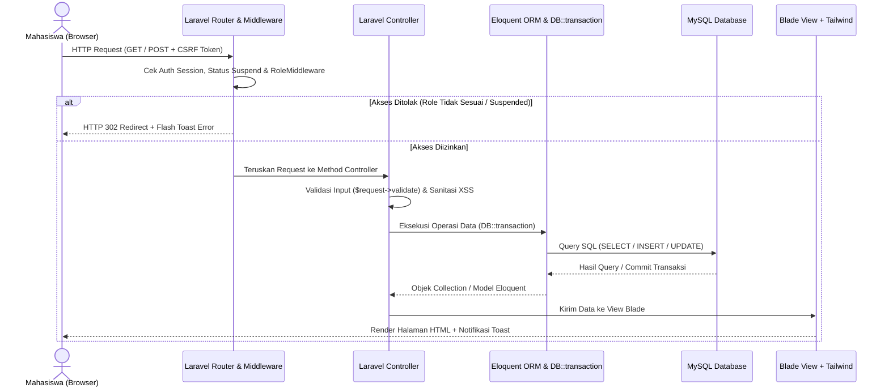
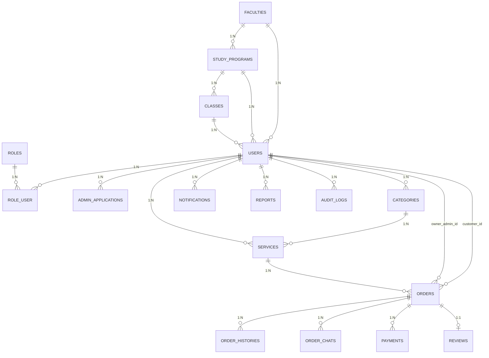
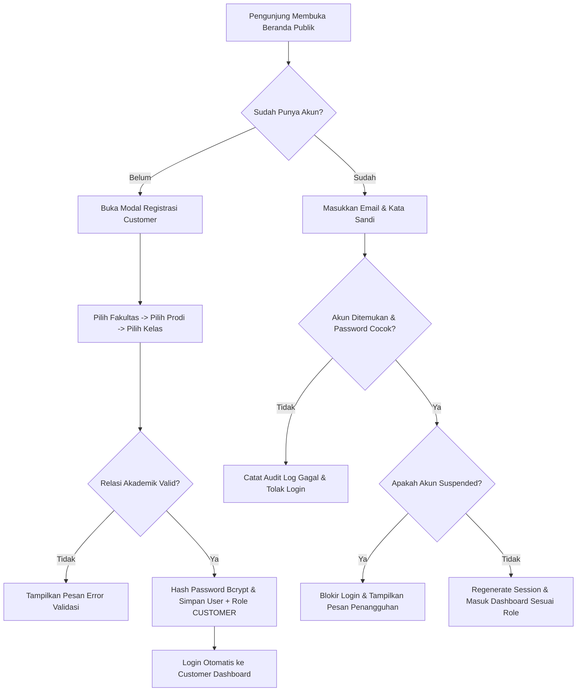
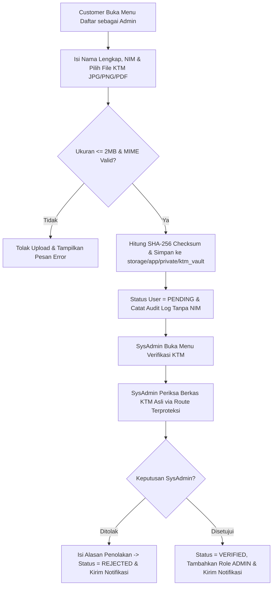
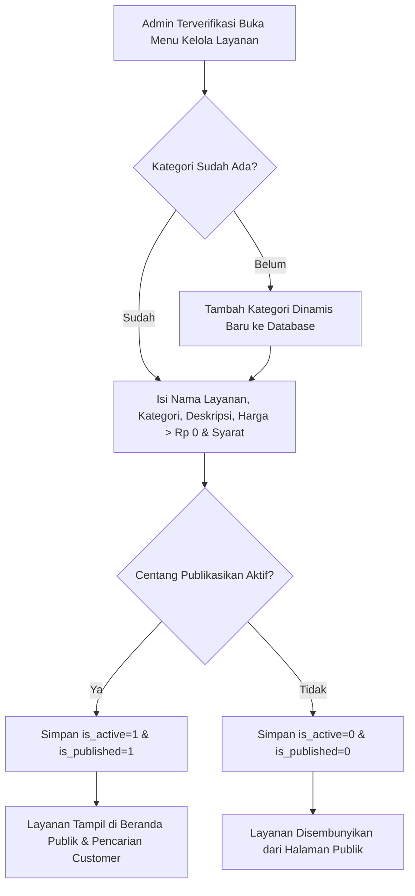
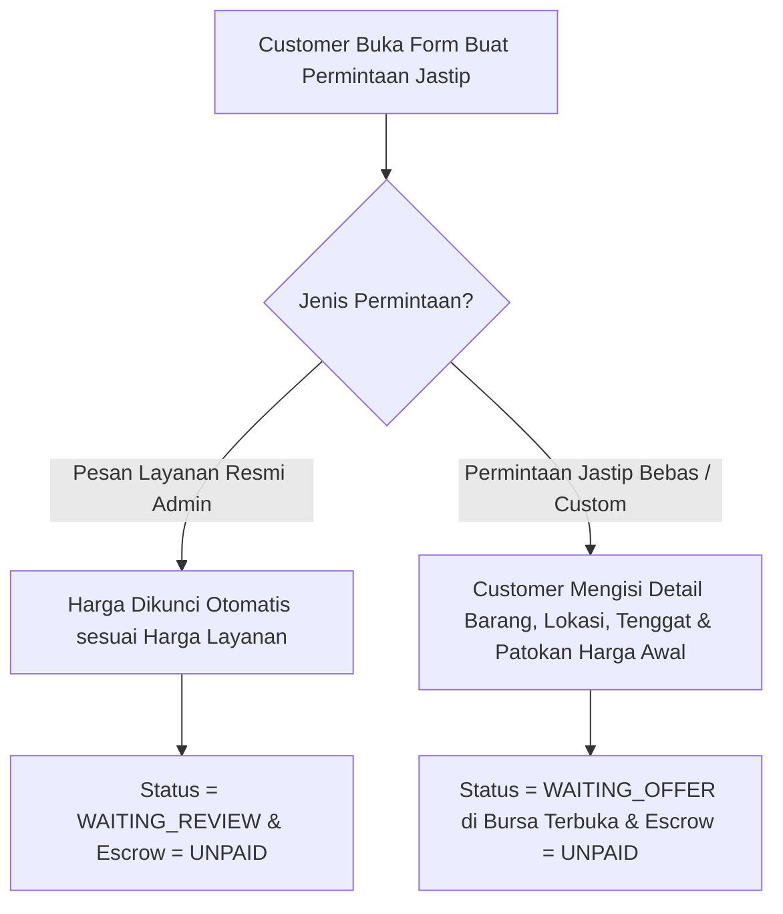
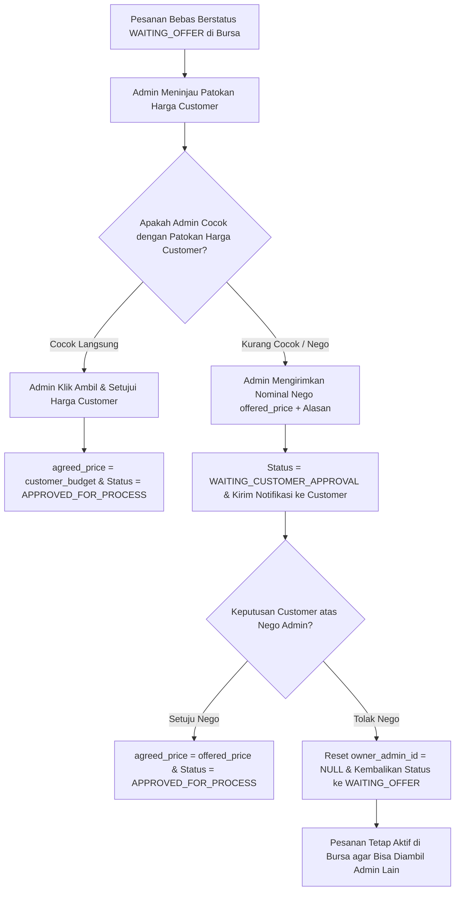
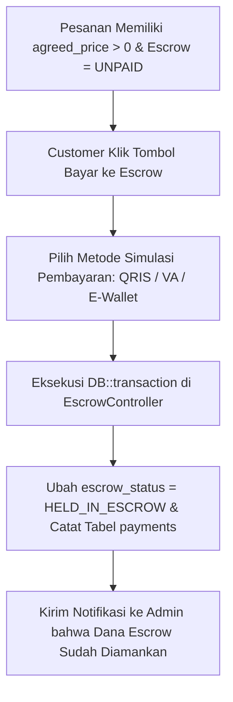
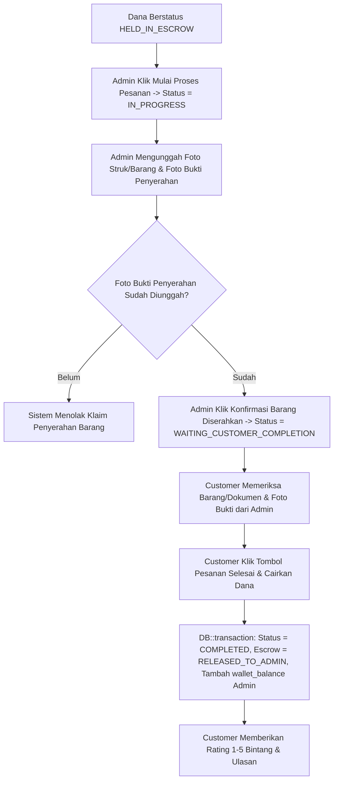
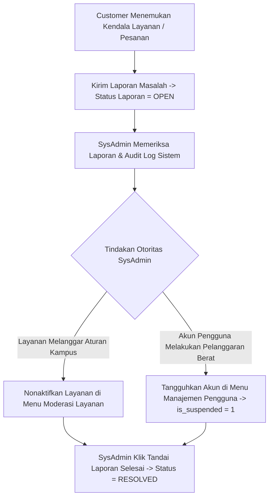

# DOKUMENTASI TEKNIS & AKADEMIS PROYEK: JASTIPKAMPUS (LARAVEL 11 + MYSQL)

## A. GAMBARAN UMUM

### 1. Pengertian JastipKampus
**JastipKampus** adalah platform aplikasi web jasa titip (*proxy buying & document assistance*) antar-mahasiswa berbasis lingkungan akademik terstruktur (Fakultas, Program Studi, dan Kelas)[cite: 1]. Aplikasi ini mempertemukan mahasiswa yang sedang berada di luar kota atau berhalangan hadir di kampus (*Customer*) dengan rekan mahasiswa aktif yang telah terverifikasi identitas Kartu Tanda Mahasiswa-nya (*Admin Layanan*) untuk membantu pengurusan dokumen akademik (seperti pengambilan KTM di BAAK, legalisir transkrip, pencetakan laporan praktikum) maupun pembelian perlengkapan perkuliahan[cite: 1].

### 2. Tujuan Aplikasi
1. Menyediakan ekosistem jasa titip khusus mahasiswa yang aman, terverifikasi, dan memiliki kejelasan afiliasi akademik (Fakultas, Program Studi, dan Kelas)[cite: 1].
2. Melindungi dana transaksi mahasiswa melalui mekanisme **Simulasi Rekening Bersama (Escrow)**, di mana dana baru diteruskan ke saldo penyedia jasa setelah pemesan mengonfirmasi barang/dokumen diterima dengan baik.
3. Memberikan fleksibilitas transaksi dua arah melalui fitur **Katalog Layanan Resmi** dan **Bursa Permintaan Bebas (*Custom Request*) dengan Patokan Harga Customer**.
4. Menjaga privasi data sensitif mahasiswa (seperti NIM, nomor telepon, dan berkas fisik KTM) agar tidak terekspos ke publik[cite: 1].

### 3. Permasalahan yang Ingin Diselesaikan
* **Risiko Penipuan Transaksi Manual:** Jasa titip antar-mahasiswa yang dilakukan lewat media sosial atau grup chat sering mengalami kendala penipuan (uang sudah ditransfer tetapi barang tidak dibelikan, atau barang sudah dibelikan tetapi pemesan menghilang).
* **Ketidakpastian Tarif Jasa (*Fee*):** Pemesan sering ragu menentukan biaya jasa titip yang wajar. Dengan fitur *Patokan Harga Customer* dan *Nego Harga Admin*, kesepakatan harga tercapai secara transparan sebelum dana disetorkan ke Escrow.
* **Pesanan Hangus Saat Nego Gagal:** Pada sistem konvensional, penolakan tawaran harga membuat pesanan langsung batal. Di JastipKampus, jika Customer menolak nego harga dari satu Admin, pesanan otomatis dikembalikan ke bursa (`WAITING_OFFER`) agar dapat diambil oleh Admin lainnya.

### 4. Pengguna Aplikasi
Aplikasi ini dirancang untuk tiga kelompok pengguna di lingkungan perguruan tinggi[cite: 1]:
1. **Mahasiswa Pemesan (*Customer*):** Seluruh mahasiswa terdaftar yang membutuhkan bantuan jasa titip[cite: 1].
2. **Mahasiswa Penyedia Jasa (*Admin Layanan*):** Mahasiswa aktif yang telah mengunggah berkas KTM asli dan disetujui oleh otoritas sistem untuk membuka layanan maupun mengambil pesanan di bursa[cite: 1].
3. **Otoritas Pengelola Sistem (*Administrator Utama / SysAdmin*):** Pihak pengelola/otoritas kampus yang bertugas memverifikasi berkas KTM, mengelola master data akademik, memoderasi layanan yang melanggar aturan, serta menangani laporan sengketa[cite: 1].

---

## B. ARSITEKTUR SISTEM

Aplikasi JastipKampus dibangun menggunakan arsitektur **Model-View-Controller (MVC)** pada kerangka kerja **Laravel 11** dengan basis data relasional **MySQL**:

1. **Frontend (Presentation Layer):**
   * Menggunakan **Laravel Blade Template Engine** untuk me-render antarmuka HTML secara dinamis di sisi server (*Server-Side Rendering*).
   * Menggunakan **Tailwind CSS** untuk mempertahankan identitas desain modern (palet warna *Navy Blue*, *Teal*, *Rose*, dan *Slate*) yang responsif di perangkat *mobile* maupun *desktop*[cite: 1].
   * Menggunakan **Alpine.js** untuk interaksi antarmuka tanpa *reload* halaman pada komponen modal (Modal Login/Registrasi, Modal Pembayaran Escrow, Modal Chat In-App) serta *Cascading Dropdown* berjenjang (Fakultas $\rightarrow$ Program Studi $\rightarrow$ Kelas).
2. **Backend (Application & Business Logic Layer):**
   * **Laravel Routing (`routes/web.php`):** Mengatur seluruh titik masuk URL HTTP (`GET` dan `POST`) yang dikelompokkan berdasarkan *prefix* peran (`customer`, `admin`, `sysadmin`).
   * **Middleware (`RoleMiddleware`):** Lapisan keamanan di sisi server yang memeriksa status autentikasi, status penangguhan akun (`is_suspended`), serta kecocokan peran pengguna sebelum permintaan diteruskan ke Controller[cite: 1].
   * **Controllers (`app/Http/Controllers/`):** Memproses logika bisnis, validasi input (`$request->validate()`), penyimpanan berkas (`Storage`), serta pembungkusan transaksi kritis dengan `DB::transaction()`.
   * **Service & Helper (`AuditAndNotificationService`, `FormatHelper`):** Menangani pencatatan *Audit Log* yang disanitasi dari data pribadi serta validasi mesin transisi status pesanan (`canTransitionOrder`)[cite: 1].
3. **Database & Storage (Data Persistence Layer):**
   * **MySQL & Eloquent ORM:** Menyimpan 18 tabel bisnis utama ditambah tabel sesi pengguna dengan integritas *Foreign Key* penuh.
   * **Laravel Local Storage:** Memisahkan penyimpanan dokumen sensitif KTM di `storage/app/private/ktm_vault` (tidak dapat diakses lewat URL publik) dan foto bukti transaksi di `storage/app/public/order_proofs`.

### Alur Komunikasi Browser — Laravel — MySQL


---

## C. PENJELASAN STRUKTUR FOLDER

Proyek ini diorganisasikan mengikuti standar arsitektur Laravel agar mudah dipelajari dan dipelihara:

* **`app/Helpers/FormatHelper.php`**: Menyimpan fungsi pembantu untuk memformat mata uang Rupiah (`formatIDR`), format waktu WIB (`formatWIB`), sanitasi input dari tag berbahaya (`sanitizeInput`), serta aturan mesin transisi status pesanan (`canTransitionOrder`)[cite: 1].
* **`app/Http/Controllers/`**: Dipisahkan ke dalam sub-folder sesuai domain tanggung jawab:
  * `Auth/AuthController.php`: Menangani login, registrasi Customer, logout, dan inisialisasi pertama SysAdmin[cite: 1].
  * `Customer/`: Berisi `CustomerDashboardController`, `CustomerOrderController`, `EscrowController`, dan `KtmApplicationController`.
  * `Admin/`: Berisi `AdminDashboardController`, `AdminServiceController`, dan `AdminOrderController`.
  * `SysAdmin/SysAdminController.php`: Menangani verifikasi KTM privat, manajemen master akademik, moderasi layanan, dan penyelesaian laporan[cite: 1].
  * `OrderChatController.php` & `QaEnvironmentController.php`: Menangani ruang diskusi pesanan dan mode simulasi QA[cite: 1].
* **`app/Http/Middleware/RoleMiddleware.php`**: Menegakkan aturan RBAC (*Role-Based Access Control*) di sisi server[cite: 1].
* **`app/Models/`**: Berisi 17 kelas Model Eloquent yang merepresentasikan tabel MySQL beserta fungsi relasinya (`belongsTo`, `hasMany`, `belongsToMany`).
* **`app/Services/AuditAndNotificationService.php`**: Layanan terpusat untuk mencatat jejak audit keamanan dan mengirimkan notifikasi internal[cite: 1].
* **`database/migrations/`**: Menyimpan definisi skema 18 tabel bisnis utama dan tabel sesi.
* **`database/seeders/DatabaseSeeder.php`**: Menyimpan data awal master Fakultas, Program Studi, Kelas, Role, dan Konfigurasi Sistem[cite: 1].
* **`resources/views/`**: Menyimpan template antarmuka Blade yang dibagi menjadi `layouts/app.blade.php`, `public/landing.blade.php`, `customer/dashboard.blade.php`, `admin/dashboard.blade.php`, dan `sysadmin/dashboard.blade.php`.
* **`routes/web.php`**: Pusat definisi seluruh rute URL aplikasi beserta proteksi middleware-nya.
* **`tests/Feature/JastipKampusTest.php`**: Berisi pengujian otomatis *Feature Test* PHPUnit untuk memverifikasi alur bisnis dan keamanan aplikasi.

---

## D. PENJELASAN DATABASE & ERD MERMAID

Basis data MySQL (`jastipkampus_db`) terdiri atas **18 tabel aplikasi utama** (ditambah tabel `sessions` bawaan Laravel):

1. **`faculties`**: Menyimpan master fakultas (`id` PK, `code` Unique, `name`, `is_active`)[cite: 1].
2. **`study_programs`**: Menyimpan master program studi (`id` PK, `faculty_id` FK ke `faculties`, `name`, `degree`, `is_active`)[cite: 1].
3. **`classes`**: Menyimpan master kelas (`id` PK, `study_program_id` FK ke `study_programs`, `name`, `cohort_year`, `is_active`)[cite: 1].
4. **`roles`**: Menyimpan master peran (`id` PK, `name` Unique: `CUSTOMER`, `ADMIN`, `SYSADMIN`, `label`)[cite: 1].
5. **`users`**: Menyimpan data pengguna (`id` PK, `faculty_id` FK, `study_program_id` FK, `class_id` FK, `wallet_balance`, `is_suspended`, `admin_verification_status`)[cite: 1].
6. **`role_user`**: Tabel *pivot* relasi *Many-to-Many* antara `users` dan `roles` (`user_id` FK, `role_id` FK)[cite: 1].
7. **`system_configs`**: Menyimpan konfigurasi global platform (`platform_name`, `allow_cross_faculty_orders`, `require_ktm_for_admin`, `max_ktm_size_mb`)[cite: 1].
8. **`admin_applications`**: Menyimpan pengajuan verifikasi KTM (`id` PK, `user_id` FK, `nim`, `ktm_checksum`, `ktm_private_path`, `status`, `reviewed_by_id` FK)[cite: 1].
9. **`categories`**: Menyimpan kategori layanan dinamis (`id` PK, `name`, `description`, `created_by` FK ke `users`)[cite: 1].
10. **`services`**: Menyimpan layanan yang dipublikasikan Admin (`id` PK, `owner_admin_id` FK, `category_id` FK, `price`, `is_active`, `is_published`)[cite: 1].
11. **`orders`**: Menyimpan pesanan layanan maupun permintaan jastip bebas (`id` PK, `order_code` Unique, `customer_id` FK, `owner_admin_id` FK, `service_id` FK, `customer_budget`, `offered_price`, `agreed_price`, `status`, `escrow_status`, `receipt_proof_path`, `delivery_proof_path`).
12. **`order_histories`**: Menyimpan riwayat kronologis perubahan status pesanan (`id` PK, `order_id` FK, `actor_id` FK, `status`, `note`)[cite: 1].
13. **`order_chats`**: Menyimpan pesan diskusi in-app per pesanan (`id` PK, `order_id` FK, `sender_id` FK, `sender_role`, `message`).
14. **`payments`**: Menyimpan mutasi simulasi setoran Escrow, pencairan ke Admin, *refund*, dan penarikan saldo dompet (`id` PK, `order_id` FK, `user_id` FK, `type`, `amount`, `payment_method`).
15. **`reviews`**: Menyimpan ulasan dan rating bintang 1–5 (`id` PK, `order_id` FK Unique, `customer_id` FK, `owner_admin_id` FK, `rating`, `comment`)[cite: 1].
16. **`notifications`**: Menyimpan notifikasi internal pengguna (`id` PK, `user_id` FK, `related_order_id` FK, `title`, `message`, `is_read`)[cite: 1].
17. **`reports`**: Menyimpan laporan masalah dari pengguna ke SysAdmin (`id` PK, `reporter_id` FK, `target_title`, `reason`, `status`, `resolved_by_id` FK)[cite: 1].
18. **`audit_logs`**: Menyimpan catatan jejak audit keamanan sistem (`id` PK, `actor_id` FK, `action`, `target_id`, `detail`)[cite: 1].

### Entity Relationship Diagram (ERD)


---

## E. PENJELASAN ROLE DAN HAK AKSES (RBAC)

| Aspek Hak Akses | 1. CUSTOMER (Mahasiswa Pemesan) | 2. ADMIN (Penyedia Jasa Terverifikasi) | 3. SYSADMIN (Administrator Utama) |
| :--- | :--- | :--- | :--- |
| **Cara Memperoleh Role** | Otomatis saat registrasi akun baru[cite: 1]. | Mengunggah KTM asli di menu *Daftar sebagai Admin* dan disetujui oleh `SYSADMIN`[cite: 1]. | Hanya melalui inisialisasi pertama kali saat tabel `SYSADMIN` masih kosong[cite: 1]. |
| **Akses Dashboard** | Hanya *Customer Dashboard*[cite: 1]. | *Customer Dashboard* **dan** *Admin Dashboard* (Multi-Peran)[cite: 1]. | Khusus *Administrator Utama Dashboard*[cite: 1]. |
| **Wewenang Transaksi** | Memesan layanan, membuat permintaan bebas + patokan harga, menyetujui/menolak nego, membayar Escrow, menekan tombol *Pesanan Selesai*, memberi ulasan. | Membuat kategori & layanan, mengambil patokan harga Customer atau mengajukan nego, mengunggah foto struk & penyerahan, mencairkan saldo dompet Escrow. | Memverifikasi berkas KTM privat, menangguhkan akun (*suspend*), mengelola Fakultas/Prodi/Kelas, memoderasi layanan, menyelesaikan laporan, memeriksa Audit Log[cite: 1]. |

---

## F. ALUR SISTEM (8 FLOWCHART MERMAID)

### 1. Alur Registrasi dan Login Mahasiswa


### 2. Alur Pengajuan Admin & Verifikasi KTM Privat


### 3. Alur Publikasi Layanan oleh Admin


### 4. Alur Pemesanan Jasa Titip (Layanan Resmi vs Permintaan Bebas)


### 5. Alur Penawaran Harga (Nego) & Tolak Nego Kembali ke Bursa


### 6. Alur Simulasi Pembayaran Rekening Bersama (Escrow)


### 7. Alur Penyelesaian Pesanan & Pencairan Dana oleh Customer


### 8. Alur Moderasi Layanan & Penanganan Laporan oleh Administrator Utama


---

## G. PENJELASAN KODE PENTING UNTUK PRESENTASI DOSEN

Bagian ini disiapkan sebagai panduan ketika dosen penguji menanyakan implementasi teknis kode Anda:

### 1. Bagaimana cara mencegah Admin nakal mencairkan dana Escrow sendiri?
**Jawaban Teknis:** Pada `AdminOrderController@updateStatus`, terdapat pengecekan eksplisit yang memblokir transisi ke `COMPLETED` apabila dipanggil oleh Admin. Admin hanya diizinkan mengubah status hingga `WAITING_CUSTOMER_COMPLETION` dengan syarat `delivery_proof_path` (foto bukti penyerahan) tidak kosong. Pencairan dana ke `wallet_balance` Admin hanya terdapat pada `CustomerOrderController@confirmCompletion` yang dibungkus dalam `DB::transaction()` dan `lockForUpdate()`.

### 2. Bagaimana cara memastikan dropdown Fakultas, Prodi, dan Kelas tidak bisa dimanipulasi?
**Jawaban Teknis:** Validasi dilakukan dua lapis. Di sisi frontend (Blade + Alpine.js), perubahan Fakultas otomatis mengosongkan pilihan Program Studi dan Kelas. Di sisi backend (`AuthController@registerCustomer` dan `CustomerDashboardController@updateProfile`), dilakukan query Eloquent untuk memastikan `study_programs.faculty_id` cocok dengan `faculty_id` yang dipilih, dan `classes.study_program_id` cocok dengan `study_program_id` yang dipilih[cite: 1].

### 3. Mengapa file KTM disimpan di `storage/app/private` sedangkan bukti struk di `storage/app/public`?
**Jawaban Teknis:** Kartu Tanda Mahasiswa (KTM) memuat data pribadi sensitif (NIM dan foto identitas) sehingga tidak boleh memiliki URL publik statis[cite: 1]. Karena itu, KTM disimpan di disk privat lokal dan hanya dapat di-*stream* melalui `SysAdminController@viewPrivateKtm` yang dilindungi oleh middleware `role:SYSADMIN`. Sebaliknya, foto bukti struk dan penyerahan barang disimpan di disk publik agar dapat dilihat langsung oleh Customer pemesan.
## H. PANDUAN INSTALASI & MENJALANKAN APLIKASI DI LOKAL (WINDOWS + XAMPP)

Ikuti langkah-langkah berikut untuk mengonfigurasi dan menjalankan proyek JastipKampus di komputer lokal Anda:

### Prasyarat Sistem
1. **PHP** Versi 8.2 atau lebih tinggi (sudah termasuk dalam bundel XAMPP terbaru).
2. **Composer** (Manajer Dependensi PHP).
3. **Node.js LTS & NPM** (Untuk pengelolaan aset frontend Tailwind CSS jika diperlukan).
4. **MySQL / MariaDB** (Aktifkan modul Apache & MySQL melalui XAMPP Control Panel).

---

### Langkah-Langkah Instalasi

1. **Ekstrak Arsip Proyek:**
   Ekstrak file `JastipKampus_Laravel_MySQL_Full.zip` ke dalam direktori *root* web server lokal Anda (contoh: `C:\xampp\htdocs\jastipkampus`).

2. **Buka Terminal / Command Prompt:**
   Arahkan direktori terminal ke folder proyek tersebut:
   ```bash
   cd C:\xampp\htdocs\jastipkampus